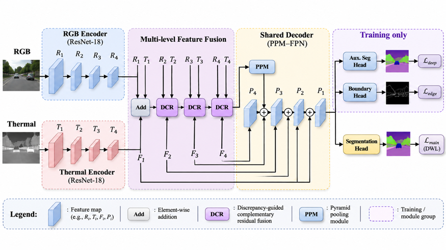
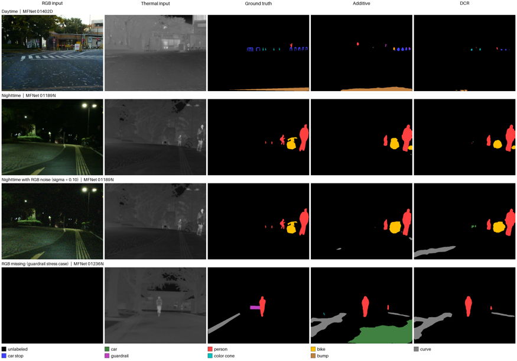

# 面向可见光-热红外语义分割的差异引导互补残差融合 (DCR)

> **Discrepancy-guided Complementary Residual (DCR) Fusion for RGB-Thermal Semantic Segmentation**

[](http://115.191.43.228:8081/)
[](https://www.python.org/)
[](https://pytorch.org/)
[](https://opensource.org/licenses/MIT)

🌐 **在线项目主页 (Project Page)**：[http://115.191.43.228:8081/](http://115.191.43.228:8081/)

---

## 👥 作者与单位 (Authors & Affiliations)

* **李奕帆**<sup>1</sup>，**董义贇**<sup>1</sup>，**宋旭婷**<sup>2</sup>，**丁悦**<sup>2</sup>
* <sup>1</sup> 上海大学 未来技术学院 (School of Future Technology, Shanghai University)
* <sup>2</sup> 上海大学 计算机工程与科学学院 (School of Computer Engineering and Science, Shanghai University)
* *硕士研究生课程《多传感器智能信息融合》课程设计项目*

---

## 📖 简介 (Introduction)

本项目是 **《面向可见光-热红外语义分割的差异引导互补残差融合方法》** 的PyTorch 代码实现仓库。

可见光（RGB）与热红外（Thermal）图像在全天候场景理解中具有天然互补性。传统的 RTFNet 等方法采用固定的 1:1 逐元素相加融合，无法显式区分两模态一致与冲突的区域。为此，本文提出了一种轻量级的**差异引导互补残差融合模块（DCR）**与**差异加权损失（DWL）**。

### ✨ 核心亮点

* **DCR 模块（差异引导互补残差融合）**：保留相加融合作为恒等主干 $S = R + T$，以独立批归一化后特征的绝对差异 $D = |R_n - T_n|$ 与共激活响应 $P = R_n \odot T_n$ 为输入，构建轻量残差校正分支。通过**零初始化逐通道系数** $\alpha$ 注入，保证训练初期严格等价于相加基线，仅在有益处实现“有益偏离”。
* **DWL 损失（差异加权损失）**：利用跨模态差异图对像素级分割损失进行均值归一化重加权，引导模型在训练过程中重点关注模态冲突与边界区域。
* **极低计算开销与高鲁棒性**：仅增加 **2.1%** 的参数量（`0.526M`）与 **0.5%** 的 FLOPs，保持 **105.2 FPS** 的实时推理速度；在七种模拟传感器退化条件下，平均 mIoU 由 `47.32%` 提升至 `49.10%`（`+1.77%`）。

---

## 🏗️ 网络结构 (Architecture)



* **编码器**：双流 ResNet-18 特征提取网络。第 1 阶段采用无参数逐元素相加；第 2 至 4 阶段语义信息丰富，嵌入 DCR 模块进行精细化跨模态校正。
* **解码器**：共享的 PPM-FPN（金字塔池化模块 + 特征金字塔网络）输出最终像素级语义分割结果。

*(网络结构图与模块细节可视化请访问 [项目主页](http://115.191.43.228:8081/) 查看)*

---

## 📊 实验结果 (Results)

在 **MFNet** 城市场景 RGB-T 语义分割数据集上的公平对比实验结果：

| 方法 (Method)            | 骨干网络 (Backbone) | 解码器 (Decoder) |  测试集 mIoU (%)  | 7种退化平均 mIoU (%) |    参数量 (M)     | 推理速度 (FPS) |
| :----------------------- | :------------------ | :--------------- | :---------------: | :------------------: | :---------------: | :------------: |
| Add. Baseline (相加基线) | ResNet-18 ×2        | PPM-FPN          |       52.17       |        47.32         |       25.03       |     129.0      |
| **DCR + DWL (Ours)**     | ResNet-18 ×2        | PPM-FPN          | **53.75 (+1.58)** |  **49.10 (+1.77)**   | **25.56 (+2.1%)** |   **105.2**    |

> *注：详细实验数据（包括昼夜分场景性能、逐类别 IoU、七种传感器退化鲁棒性测试及消融实验）请参阅课程设计报告正文或 [在线项目主页](http://115.191.43.228:8081/)。*




---

## 🛠️ 环境配置与要求 (Requirements)

为了复现本文实验结果，请确保您的运行环境满足以下要求：

* **操作系统**: Linux 或 Windows（推荐 Ubuntu 20.04+）
* **Python**: 3.8 或更高版本
* **PyTorch**: 1.10+（推荐 1.12 及以上）
* **CUDA**: 11.3 及以上
* **GPU**: 显存 ≥ 8GB（如 NVIDIA RTX 3060 / RTX 5070 Ti Laptop 等）

### 安装依赖

```bash
# 1. 克隆本项目仓库
git clone https://github.com/nac-max/MultiSensor-DCR.git

# 2. 创建并激活 Conda 虚拟环境（可选）
conda create -n dcr python=3.8 -y
conda activate dcr

# 3. 安装依赖包
pip install -r requirements.txt
```

---

## 🚀 快速开始 (Quick Start)

### 1. 数据集准备

1. 访问 [MFNet 官方网站](https://www.mi.t.u-tokyo.ac.jp/static/projects/mil_multispectral/) 下载数据集压缩包并解压。
2. 将解压后的 RGB 图像、热红外图像与标注掩码按以下目录结构组织（默认存放于 `data/MFNet/`）：

```text
data/
└── MFNet/
    ├── images/          # 或按模态拆分：rgb/ 与 thermal/，视 dataloader 约定而定
    │   ├── 00001D.png   # 建议保留原始文件名或统一命名规则，确保 RGB 与 Thermal 一一对应
    │   └── ...
    ├── labels/          # 语义分割真值标签（单通道索引图，像素值对应类别 ID）
    │   ├── 00001D.png
    │   └── ...
    └── splits/          # 数据划分索引文件（不含后缀名，每行一个样本 ID）
        ├── train.txt
        ├── val.txt
        └── test.txt
```
### 2. 模型训练 (Training)

使用默认配置在 MFNet 训练集上启动 DCR + DWL 联合训练：

```bash
python train.py --model add_fusion --recipe v3 --seed 42 --exp v3_add_s42
python train.py --model dcr --recipe v3 --seed 42 --exp v3_dcr_s42

```

消融实验：

```bash
python train.py --model dcr --recipe v3 --no_dwl --exp v3_dcr_no_dwl
python train.py --model dcr --recipe v3 --no_spatial --exp v3_dcr_no_spatial
python train.py --model dcr --recipe v3 --no_cross --exp v3_dcr_no_cross
```

### 3. 模型评估与推理 (Evaluation)

以 v3_dcr_s42 为例，其他模型把这个名字换成对应的 exp 名即可：
```bash
python eval.py --checkpoint runs/v3_dcr_s42/best.pt --output results/v3_dcr_s42.json
python robustness_sweep.py --checkpoint runs/v3_dcr_s42/best.pt --output results/v3_dcr_s42_robust.md
python diag.py --checkpoint runs/v3_dcr_s42/best.pt
```

- eval.py：测试集 mIoU，并分白天和夜间。
- robustness_sweep.py：8 种破坏下的鲁棒性。
- diag.py：DCR 每一层的校正强度。


### 4. 可视化 (Visualization)

```bash
python visualize.py --root /path/to/MFNet --checkpoint runs/mfnet_rcaf/best.pt --count 4 --output results/rcaf_vis
```

---

## 📝 引用与致谢 (Citation & Acknowledgements)

如果您在研究或课程学习中参考了本项目的代码或思路，欢迎访问我们的项目主页并引用本工作：

```bibtex
@misc{li2026dcr,
  title={面向可见光-热红外语义分割的差异引导互补残差融合方法 (Discrepancy-guided Complementary Residual Fusion for RGB-Thermal Semantic Segmentation)},
  author={李奕帆 and 董义贇 and 宋旭婷 and 丁悦},
  year={2026},
  howpublished={\url{http://115.191.43.228:8081/}},
  note={Course Project of Multi-sensor Intelligent Information Fusion, Shanghai University}
}
```

感谢 [RTFNet](https://github.com/yuxiangsun/RTFNet) 与 [MFNet](https://www.mi.t.u-tokyo.ac.jp/static/projects/mil_multispectral/) 为开源社区提供的优秀基线代码与数据集支持。

---

## 📄 开源协议 (License)

本项目基于 [MIT License](LICENSE) 开源。